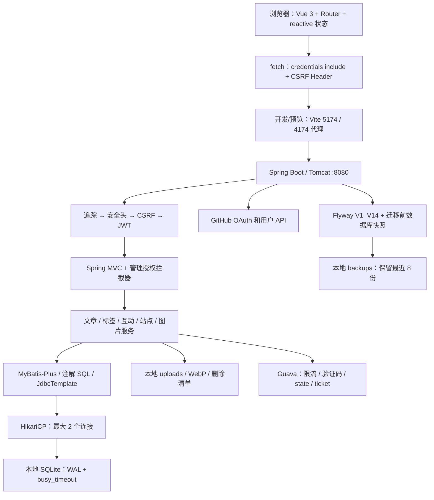
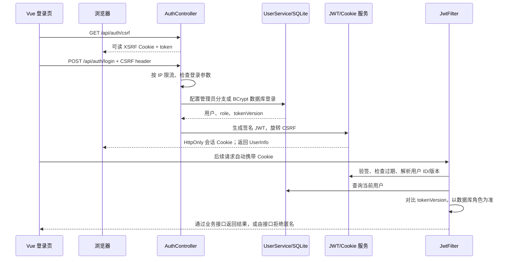
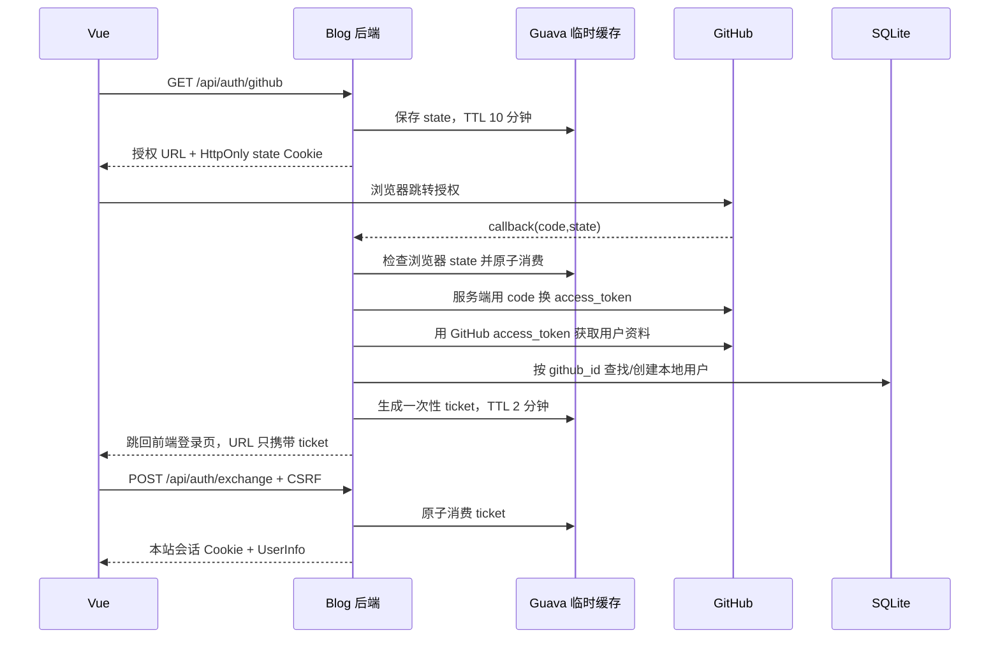
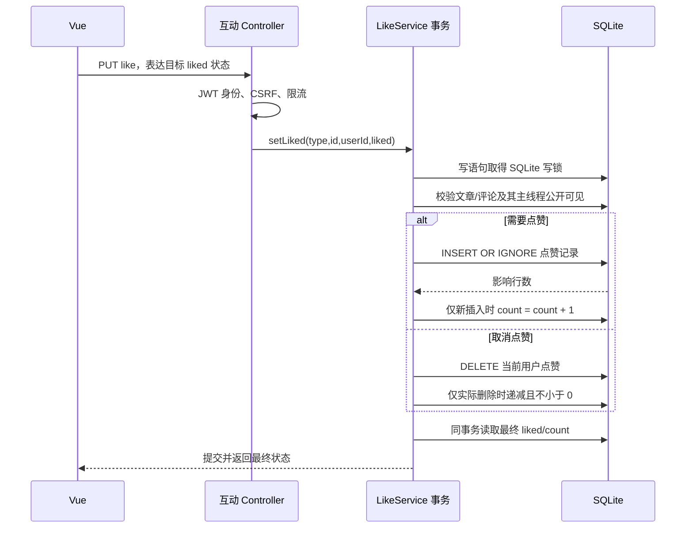

# 项目架构与核心流程

> 2026-10-17 更新：本文主体保留 2026-10-09 的源码审查快照；部分缺陷随后已修复，当前状态见 [修复记录](E:/AAZ-StudyProfileslib/SelfWebBlog/docs/interview-review/04-Code-Review与优化建议.md)。历史行号可能已移动。

审查日期：2026-10-09。对象：当前工作区完整项目，基线提交 `8e28f227c655f18737216649021e324f774262c9`，分支 `codex/gabriel-fullstack-rebuild`。开始审查时 `AuthController.java` 已有移除旧管理员登录入口的修改；本次分析包含该工作区状态，未修改业务代码。

## 1. 阅读边界与结论标签

- **源码证实**：从当前代码、构建文件、迁移 SQL 或测试实现能够直接确认。
- **合理推断**：存在明确触发条件，但本次没有启动服务、访问真实数据库或线上环境复现。
- **通用原理**：用于解释底层机制，不等于本人实现过该机制。
- **改进建议**：尚未实施；不能写成已有项目成果。
- **待验证 / 待本人确认**：实际部署、历史故障、个人贡献、性能指标等，仓库不能证明。

扫描覆盖 111 个主 Java 文件、49 个 Java 测试文件、84 个前端 JS/Vue 文件（含 21 个 JS 测试文件）、14 个 Flyway 迁移。阅读了入口、配置、认证、文章、标签、互动、资产、站点、管理接口与对应前端调用，也核对了开发脚本和 CI。历史设计文档和 README 只作为线索，最终以当前实现为准。

## 2. 项目概述

**源码证实**：这是一个前后端分离、以单实例和本地持久化为基础的个人博客。Spring Boot 提供 JSON API、上传文件访问和健康检查；Vue 3 提供阅读与管理界面；SQLite 保存业务数据，本地目录保存图片、数据库备份和可选 IP 地域库。

实际功能包括文章草稿、发布、归档与批量操作，标签维护，文章搜索和日期聚合，账号注册与密码登录、GitHub 登录、个人资料、文章评论和匿名留言、回复、审核、置顶排序、点赞、按日访客标识去重的文章浏览记录、图片上传与 WebP 派生图、资源引用检查与孤立资源删除、站点资料和链接管理、管理面板与安全审计。

这里的“按日去重浏览”使用 IP 与 User-Agent 派生标识，不能称为真实独立用户统计。管理员身份是 `ADMIN/USER` 两种角色，不是可配置的完整 RBAC。没有源码证据支持高并发能力、线上吞吐量或性能优化百分比。

## 3. 实际技术栈与版本

| 层次 | 实际使用 | 版本证据与说明 |
| --- | --- | --- |
| Java / 构建 | Maven、Java 17 编译目标 | [pom.xml](E:/AAZ-StudyProfileslib/SelfWebBlog/SelfWebBlog/pom.xml:30)；此前本机测试使用 JDK 21，CI 配置 JDK 17 |
| Web 框架 | Spring Boot、Spring MVC、嵌入式 Tomcat | Boot **3.2.12**；[父 POM](E:/AAZ-StudyProfileslib/SelfWebBlog/SelfWebBlog/pom.xml:8) |
| 数据访问 | MyBatis-Plus、注解 SQL、JdbcTemplate、HikariCP | MP **3.5.9**；不是 JPA。存在多种访问方式，复杂互动和统计使用显式 SQL |
| 数据库 / 演进 | SQLite JDBC、Flyway V1–V14 | 版本由 Boot 管理；本地已有测试 classpath 对应 SQLite JDBC **3.43.2.2**、Flyway **9.22.3**，不代表线上运行版本 |
| 认证 / 加密 | JJWT、BCrypt、AES-GCM、HMAC-SHA256 | JJWT **0.12.6**；只引入 Spring Security crypto，不是完整 Spring Security 认证链 |
| 本地缓存 | Guava Cache | **33.3.1-jre**，用于验证码、OAuth state/票据和限流；没有 Redis |
| 图片 / 地域 | ImageIO、WebP ImageIO、ip2region | WebP **0.10.2**、ip2region **3.3.7**；xdb 文件是否实际配置待验证 |
| 前端 | Vue 3、Vue Router、Vite | lockfile：Vue **3.5.31**、Router **4.6.4**、Vite **8.0.3**；package.json 使用版本范围 |
| 渲染 / UI | marked、DOMPurify、lucide-vue-next、qrcode | lockfile：marked **18.0.3**、DOMPurify **3.4.3**、lucide **0.460.0**、qrcode **1.5.4** |
| 前端状态 / 网络 | 模块级 `reactive` 状态、原生 fetch | 没有 Pinia/Vuex；当前请求没有使用 Axios |
| 测试 / 工具 | JUnit、MockMvc、Mockito、node:test、Playwright、ESLint、Prettier | Playwright **1.61.1**；前端包和脚本见 [package.json](E:/AAZ-StudyProfileslib/SelfWebBlog/SelfWebBlog/blog-frontend/package.json:6) |

进一步可见的本地测试依赖为 Spring Framework 6.1.15、Tomcat 10.1.33、MyBatis 3.5.16、mybatis-spring 3.0.4、HikariCP 5.0.1、security-crypto 6.2.8、Lombok 1.18.36。这些是本地已有 classpath 证据，不是另行安装或线上探测所得。

**使用边界**：Axios、CodeMirror、NProgress 虽声明为依赖，未发现当前 `src` 实际导入；编辑器使用 textarea。未发现 MySQL、Redis、消息队列、微服务、WebFlux、业务异步线程池、自定义 `@Aspect`、完整 OAuth2 client starter。事务使用框架代理，不能因此宣称自己实现了 AOP 框架。

## 4. 目录与职责

后端源码根目录为 `E:/AAZ-StudyProfileslib/SelfWebBlog/SelfWebBlog/src/main/java/org/example/selfwebblog/`，下表按该目录缩写。

| 目录 | 职责 | 代表入口 |
| --- | --- | --- |
| `controller/` | 认证、文章、旧评论、用户、上传、标签与旧资料 API | `AuthController`、`PostController` |
| `service/`、`service/impl/`、`mapper/`、`entity/` | 传统业务分层和 MyBatis-Plus CRUD | `UserService`、`PostServiceImpl` |
| `security/` | Cookie JWT、CSRF、请求追踪、安全响应头、代理 IP、限流、OAuth 临时状态 | `JwtFilter`、`SessionCookieService` |
| `content/post/`、`content/tag/`、`content/calendar/` | 文章状态与内容策略、标签关系、月历查询 | `PostStatusPolicy`、`TagService` |
| `interaction/` | 新评论/留言统一模型、线程、审核、置顶、点赞和隐私元数据 | `InteractionService`、`LikeService` |
| `analytics/` | 浏览去重、点赞 SQL、文章互动接口 | `PostViewService`、`EngagementMapper` |
| `upload/asset/`、`service/upload/` | 图片校验、存储、变体、资源引用和删除恢复 | `ImageAssetService`、`ImageValidator` |
| `site/`、`admin/` | 站点资料、链接、统计、资源管理、管理授权与审计 | `SiteProfileService`、`AdminAuthorizationInterceptor` |
| `config/`、`exception/` | 数据目录、迁移备份、种子数据、分页、过滤器装配、响应与异常 | `WebConfig`、`GlobalExceptionHandler` |
| `src/main/resources/db/migration/` | 14 个版本化数据库迁移 | V4 互动、V6 标签、V12/V14 置顶约束 |
| `src/test/java/` | 单元测试、MVC 合约测试和部分真实 SQLite 集成测试 | 不等于已通过完整测试或已有覆盖率指标 |

前端根目录为 `E:/AAZ-StudyProfileslib/SelfWebBlog/SelfWebBlog/blog-frontend/`。

| 目录 / 文件 | 职责 |
| --- | --- |
| `src/main.js`、`App.vue`、`router.js` | 应用创建、外壳、路由与页面切换 |
| `src/pages/` | 首页、文章、归档、标签、登录、资料、写作与管理等页面 |
| `src/components/` | 文章卡片、Markdown、安全评论渲染、搜索、互动线程、指针效果等 |
| `src/features/admin/` | 管理面板各业务区域 |
| `src/api/client.js` | fetch、Cookie 携带、CSRF 头、响应校验和端点映射 |
| `src/stores/app.js` | `reactive` 用户、站点、初始化状态与通知 |
| `src/core/` | 草稿、归档、线程点赞队列、媒体路径、外观设置等可测试逻辑 |
| `e2e/` | Playwright UI 流程；核心 API 使用路由 mock |

根目录还有 `start-dev.bat`、`stop-dev.bat` 与 PowerShell 验证脚本，服务于 Windows 本地开发；`.github/workflows/ci.yml` 服务于 CI。没有根 README；前端 README 的 Axios 拦截器、部分目录结构等描述落后于当前源码。

## 5. 实际架构

**待验证**：生产入口如何提供前端静态文件、是否使用 Linux/Nginx、TLS 在哪里终止、域名和 DNS、服务进程管理、数据盘和备份位置。仓库没有相应部署文件，因此图中没有把 Nginx 或云服务写成现状。

## 6. 完整请求执行链路

以后台修改文章为例：Vue 页面调用 `api.savePost` → fetch 写请求先获得 CSRF token → 浏览器自动携带会话 Cookie → Vite 代理 `/api`（开发场景）→ Tomcat → 四个 Filter → DispatcherServlet 匹配 Controller → `AdminAuthorizationInterceptor` 检查 `@AdminOnly` → JSON 转对象及参数校验 → 文章策略和事务 → Mapper → JDBC/Hikari → SQLite → `ResultHttpStatusAdvice` 设置真实 HTTP 状态、traceId、必要的 Retry-After → Jackson 序列化 JSON → fetch 校验状态和业务 code → 页面更新。

证据：[WebConfig.java:64](E:/AAZ-StudyProfileslib/SelfWebBlog/SelfWebBlog/src/main/java/org/example/selfwebblog/config/WebConfig.java:64)、[管理拦截器](E:/AAZ-StudyProfileslib/SelfWebBlog/SelfWebBlog/src/main/java/org/example/selfwebblog/admin/security/AdminAuthorizationInterceptor.java:40)、[响应 Advice](E:/AAZ-StudyProfileslib/SelfWebBlog/SelfWebBlog/src/main/java/org/example/selfwebblog/config/ResultHttpStatusAdvice.java:33)、[前端 client](E:/AAZ-StudyProfileslib/SelfWebBlog/SelfWebBlog/blog-frontend/src/api/client.js:8)。

异常边界：Controller/Service 异常通常进入 `@RestControllerAdvice`；Filter 位于 MVC 外层，其异常不会天然经过该 Advice。CSRF Filter 自己返回 403 JSON。无效 JWT 被当作匿名继续处理，具体接口再决定返回 401/403。

### 6.1 密码登录与后续身份校验

实现位置：[登录](E:/AAZ-StudyProfileslib/SelfWebBlog/SelfWebBlog/src/main/java/org/example/selfwebblog/controller/AuthController.java:244)、[JWT 生成](E:/AAZ-StudyProfileslib/SelfWebBlog/SelfWebBlog/src/main/java/org/example/selfwebblog/security/JwtUtil.java:29)、[JwtFilter](E:/AAZ-StudyProfileslib/SelfWebBlog/SelfWebBlog/src/main/java/org/example/selfwebblog/security/JwtFilter.java:30)。Token 默认 7 天，无刷新接口；退出增加用户 `tokenVersion` 并清 Cookie，因此使该用户所有旧版本会话失效。每次带有效 Token 的请求仍查数据库，不能介绍成完全无状态、完全免查库。

### 6.2 GitHub 第三方登录

证据：[GitHub 起点](E:/AAZ-StudyProfileslib/SelfWebBlog/SelfWebBlog/src/main/java/org/example/selfwebblog/controller/AuthController.java:298)、[回调](E:/AAZ-StudyProfileslib/SelfWebBlog/SelfWebBlog/src/main/java/org/example/selfwebblog/controller/AuthController.java:313)、[ticket 兑换](E:/AAZ-StudyProfileslib/SelfWebBlog/SelfWebBlog/src/main/java/org/example/selfwebblog/controller/AuthController.java:383)。GitHub access_token 与本站 JWT 用途不同。虽然请求 `user:email` scope，当前代码没有调用 emails API，创建 GitHub 用户传入 email 为 null；不能说已实现邮箱同步或账号自动合并。临时状态仅在本 JVM，重启或多实例切换可能导致流程失败。

### 6.3 点赞：唯一约束与计数一致性

证据：[LikeService.java:23](E:/AAZ-StudyProfileslib/SelfWebBlog/SelfWebBlog/src/main/java/org/example/selfwebblog/interaction/LikeService.java:23)、[EngagementMapper.java:15](E:/AAZ-StudyProfileslib/SelfWebBlog/SelfWebBlog/src/main/java/org/example/selfwebblog/analytics/EngagementMapper.java:15)、[V5 唯一约束](E:/AAZ-StudyProfileslib/SelfWebBlog/SelfWebBlog/src/main/resources/db/migration/V5__post_engagement.sql:10)。浏览记录采用另一套 `(post_id,visitor_hash,view_date)` 唯一键。这里的锁是 SQLite 数据库写锁，不是 MySQL 行锁。

### 6.4 文章、评论、资源链路的关键规则

- **文章**：只允许草稿创建或直接发布；已发布可归档，归档可重新发布，不支持发布后回草稿。公开查询只读 PUBLISHED；发布时间与创建时间分离。写作页有本地草稿、上传占位替换、未完成上传阻止保存及离页清理。证据：`PostController.savePost/applyStatus`、`PostStatusPolicy`、`WritePage.vue`。
- **互动**：POST 评论要求登录，GUESTBOOK 允许匿名并验证验证码。回复统一归属根评论；公开新接口先分页根，再批量查子回复、用户和点赞状态。未信任匿名留言或带链接内容可能进入 PENDING。身份资料取当前用户，用户不存在时保留快照。IP 使用可审计的密文与不可直接回推的 HMAC 标识。证据：`InteractionService.create/getThread/projectProfiles`。
- **置顶**：仅公开根评论能置顶；排序在事务中维护，交换时用临时位置避免唯一键冲突；V12 部分唯一索引、V14 触发器兜底。不是仅依赖页面排序。
- **资源**：按上传者、用途、内容哈希复用；生成 WebP；对所有文章（含草稿、归档）及站点资料检查引用，保留 24 小时宽限。删除先暂存文件和恢复清单，数据库事务结束后提交删除或回滚恢复，启动时尝试恢复遗留暂存。不是数据库事务自动回滚磁盘。

## 7. 数据模型与约束

| 表 | 主体字段 / 关联 | 实际约束与注意点 |
| --- | --- | --- |
| `user` | username、password、github_id、role、token_version、registration_ip_hash | username/github_id 唯一；密码 BCrypt；密码字段不序列化；删除用户并无全部外键级联 |
| `post` | 标题正文、分类、状态、展示背景、创建/更新/发布/归档时间、计数 | 主键；状态与发布时间索引；状态合法性主要由 Java 策略约束 |
| `comment` | target_type/id、root_id、reply_to_id、身份快照、状态、置顶位置、IP 元数据 | 状态 CHECK、目标/状态/时间索引、根索引、置顶部分唯一索引和触发器；多态目标没有普通 FK |
| `tag` / `post_tag` | 标签名称/slug；文章标签关联 | 名称和 slug 不区分大小写唯一；关联复合主键；迁移声明 post/tag 外键；仍保留 `post.tags` 兼容文本 |
| `interaction_like` | target_type/id、user_id | 三字段唯一；没有可保证全体多态引用的简单 FK |
| `post_daily_view` | post_id、visitor_hash、view_date | 三字段唯一；按日期索引；统计近似访问而非真实用户数 |
| `image_asset` | 哈希、用途、原图/变体路径、尺寸、上传者、引用状态 | 上传者/哈希/用途唯一；复用查询与状态约束有冲突，见第 04 份报告 |
| `blog_info` / `site_link` | 博主资料、站点正文背景、独立链接顺序 | blog_info 主要使用 id=1；链接 enabled CHECK、顺序索引 |
| `security_event` | 行为、操作者、目标、IP 标识、结果、trace | 行为/操作者/时间索引；不是完整监控平台，未见保留期清理 |

**待验证**：未发现对每个 SQLite 连接显式设置 `foreign_keys=ON` 的生产代码或配置。迁移声明了外键不等于运行连接一定执行外键约束。本次没有查询实际 DB 的 PRAGMA 或迁移历史。

## 8. 关键决策与权衡

| 决策 | 当前收益 | 代价 / 边界 | 可选替代（未实施） |
| --- | --- | --- | --- |
| SQLite + 本地文件 | 部署组件少，适合个人站点 | 单写者、与主机磁盘绑定；事务和并发设计仍重要 | 增长需求明确后迁 MySQL/PostgreSQL，重写 SQLite 专用 SQL |
| JWT Cookie + tokenVersion | JS 无须读取 Token，可主动撤销旧版本 | 每请求查用户，Cookie 写请求必须防 CSRF | 服务端 Session；短 Token + refresh 需另做生命周期设计 |
| 自定义 Filter / 管理注解 | 小系统授权路径直观 | 安全职责分散、兼容接口更易漏策略 | 使用完整 Spring Security 并保留领域授权 |
| Guava 本地状态 | 实现简单、延迟低 | 重启丢失、多实例不共享；不是分布式限流 | 只有扩展多实例时考虑共享状态 |
| 混合 MP / SQL / JDBC | CRUD 简洁，复杂约束可明确控制 | 风格分散，方言迁移成本增加 | 统一事务与领域边界，按查询需求选择访问方式 |
| Vue 模块级 reactive | 足够小项目共享登录与站点状态 | 没有现成状态插件、统一过期处理待完善 | 状态复杂后再引入 Pinia |
| 文件暂存补偿 | 提升删除失败与重启恢复能力 | 不提供分布式原子性；仍需恢复验证和完整备份 | 对象存储与异步任务仅在规模需要时评估 |

## 9. 构建、运行与部署证据

源码配置的默认 profile 是 dev，后端 8080，前端开发 5174、preview 4174；Vite 代理 `/api`、`/uploads`、`/actuator` 到 localhost:8080。数据目录默认用户目录下 `.selfwebblog`，可通过 `BLOG_DATA_DIR` 指定；生产 profile 并没有自动切换到配置注释所写的 `/data`。

构建入口是后端目录的 Maven 生命周期和前端 package.json 的 pnpm 脚本。前端 `check` 包括格式、lint、单测、build；`check:all` 另含 Playwright。仓库存在 Maven wrapper properties，但没有可用的已跟踪 `mvnw` 脚本，不能直接承诺 `./mvnw`。

CI 在 push master/codex/**、PR 至 master 时运行后端 Maven 测试与前端 check，使用 Ubuntu、Java 17、Node 20、pnpm 10.25.0。Vite 8 的锁文件要求 Node `^20.19.0 || >=22.12.0`，README 的“20+”不够精确。CI 未配置部署，也未配置执行 Playwright；本次没有读取远程 CI 成功记录。

prod 校验器检查密钥、管理员开发默认配置、Secure Cookie、HTTPS 前端地址及 CORS 等，但必须实际启用 prod 才生效。配置没有内嵌 TLS，`forward-headers-strategy: none`；反向代理头信任和 TLS 响应头需要结合真实部署验证。没有证据证明 Linux 运维、Nginx HTTPS、CD、告警或周期性备份已完成。

## 10. 本次验证与复习入口

本次执行既有前端纯 node:test 测试：**77 项通过，0 项失败**，fetch 为 mock；没有启动服务、安装依赖或访问真实数据。会话此前在当前认证修改下运行 `ApiNamespaceTest`：**3 项通过**，仅证明这组接口合约。未重跑完整后端、UI E2E、构建或压测，不能把本次结果扩大为全项目验证。

随后按顺序阅读：`02-技术知识点详解.md` 理解原理 → `03-面试题与参考答案.md` 练口述 → `04-Code-Review与优化建议.md` 理解边界 → `05-简历包装与项目介绍.md` 练表达 → `06-复习路线与知识盲区.md` 安排 14 天复习。
